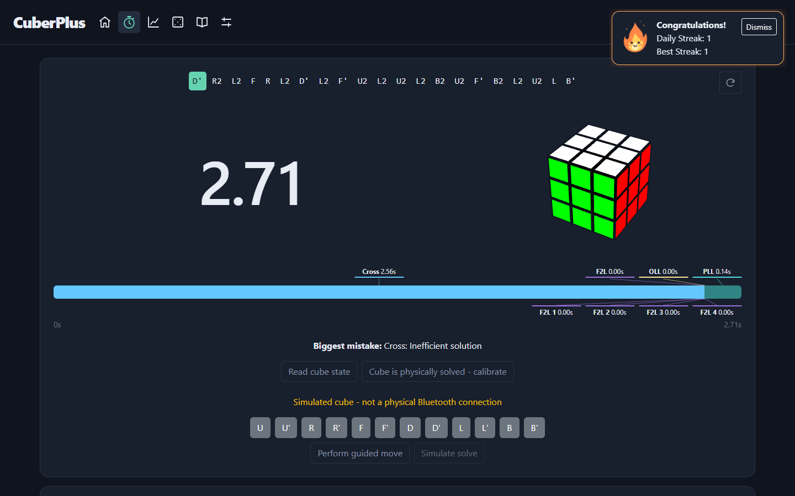
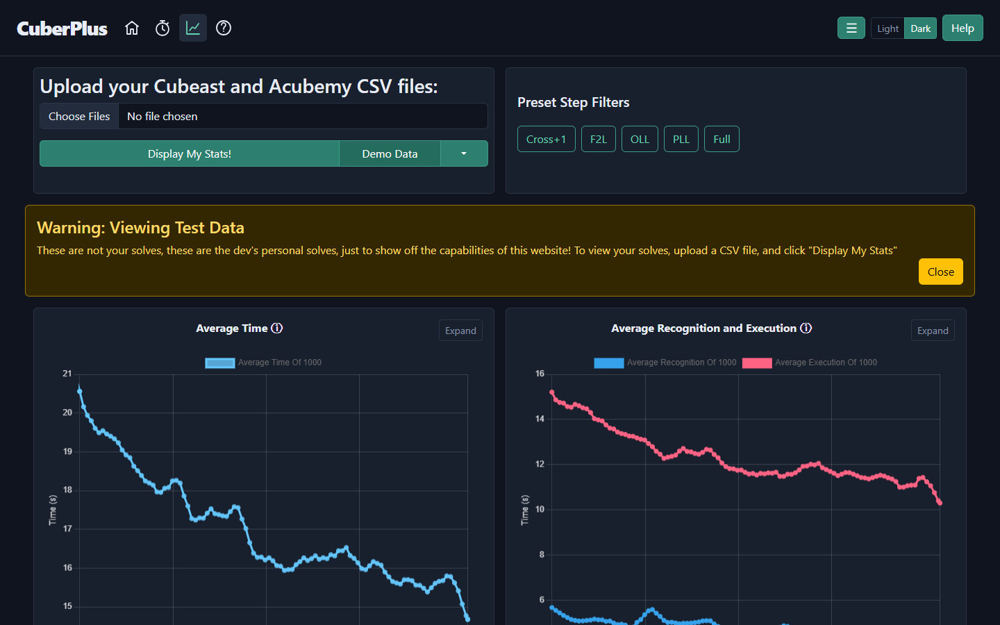
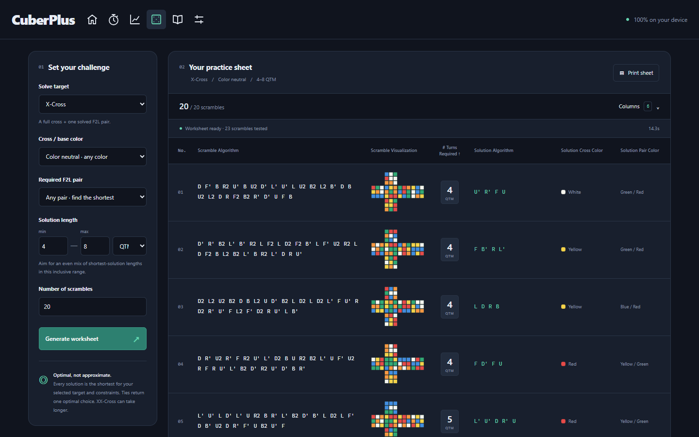
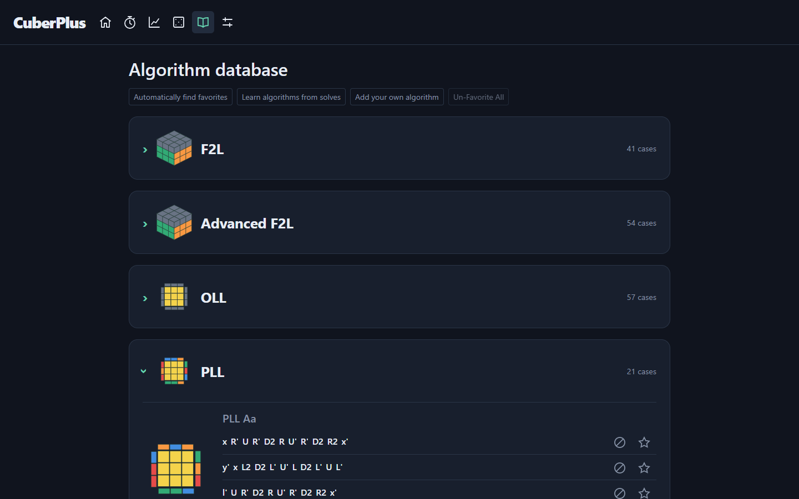

# CuberPlus

A browser-based suite for smart-cube timing, solve analysis, algorithm learning,
and printable practice worksheets. One React/Vite app serves all tools at
[cuberplus.com](https://cuberplus.com).

| Tool | Route | Purpose |
| --- | --- | --- |
| Timer | `/timer/` | Bluetooth timing, CFOP splits, replay, sessions, and records |
| Smartcube Analyzer | `/analyzer/` | Timing, efficiency, mistakes, and case-level statistics |
| Scrambler | `/scrambler/` | Optimal partial-cube practice worksheets |
| Algorithm database | `/database/` | F2L, Advanced F2L, OLL, and PLL algorithms and favorites |
| Options | `/options/` | Theme, time precision, CSV imports, and cloud backups |

## Screenshots

Timer, Scrambler, and Analyzer documentation screenshots use **Dark**, without
changing the site's default Aurora theme.






## Develop

Use Node.js 22.12+ and Git. Run every command from the repository root:

```powershell
npm ci
npm start
```

Development serves the site at `http://127.0.0.1:5173`. There are no separate
per-tool installations or builds. All cube solvers, chart workers, and
dependencies are bundled.

```powershell
npm test
npm run build
npm run preview
```

The build typechecks and lints application code, shared modules, maintenance
scripts, and Vite configuration before writing `build/`. Compiler and lint
rules reject implicit returns, unused declarations, implicit dictionary-property
access, unsafe types, and redundant assertions. Preview serves that directory at
`http://127.0.0.1:4173`. With preview running, browser checks use locally installed
Microsoft Edge:

```powershell
npm run test:site
node tests\browser\check-timer-data.mjs
node tests\browser\check-solve-workflows.mjs
```

Jest uses experimental VM modules for Timer because cubing.js is ESM-only.
Tests include independent cube-model comparisons, parser fixtures, component
behavior, and load-time/solver performance budgets. Production declarations
must not use `any` or `unknown`. Analyzer production lines must remain flat or
shrinking; tests are exempt. See the root and Analyzer `AGENTS.md` files for
contributor instructions.
ESLint also caps classic cyclomatic complexity at 130 per function.

Maintenance scripts run with Node's TypeScript support:

```powershell
node --experimental-strip-types scripts\capture-database.ts
node --experimental-strip-types scripts\generate-case-images.ts
node --experimental-strip-types scripts\update-alternatives.ts
```

`npm run test:tooling` checks the scripts, early theme bootstrap, and raw grid
stylesheet delivery; it also runs as part of `npm test`. The grid stylesheet is
read directly from the installed dependency and emitted without CSS minification,
which preserves its cascade layers without maintaining a duplicate copy.

## Repository layout

All automated checks live in `tests/`: `site`, `timer`, `analyzer`, and
`scrambler` contain Jest suites; `mocks` holds shared test doubles; `browser`
contains the Playwright workflow checks.

Site pages live in `src/Pages`, alongside the existing `database`, `cloud`,
and `pwa` modules. Timer separates `Components`, `Core`, `Analysis`, `Data`,
`Bluetooth`, `Hooks`, and `CSS`. Analyzer separates `Components`, `Models`,
`Data`, `Analysis`, `Charts`, `Workers`, `Helpers`, and `CSS`. Shared cube,
statistics, worker, configuration, and UI code lives under `shared/`.

## Timer

Use Chrome or Edge on Windows over HTTPS or localhost. Connect a compatible
Bluetooth cube, or choose **Try simulated cube**. Some encrypted cubes require
a Bluetooth MAC address; the Timer links to instructions for finding it.
The Bluetooth dependency's checked-in patch is applied by `npm ci`.
Connection and GATT discovery have separate 15-second deadlines.

Follow the highlighted scramble moves. The first solve turn starts timing,
the solving turn stops it, and the next scramble prepares automatically.
Wrong turns produce shortened undo instructions. At ten correction moves,
the local solver finds a fresh path to solved, then restarts the same scramble;
incoming moves remain buffered during calculation. These recovery paths are
short and fast, not guaranteed minimum-move solutions. Only confirm calibration
when the physical cube is solved.
Calibration also requests a hardware reset on cubes advertising that capability;
other cubes retain the local solved-state confirmation.

The CFOP timeline follows the first aligned cross, four solved F2L pairs,
OLL, and PLL including final AUF. Recognition/execution splits are inferred
from move gaps, not measured thinking time. Skips consume no time.
Click the finished timeline or a history **View** action to open solve details.
Native recordings support playback, timeline seeking, individual moves,
retries, reversible +2/DNF buttons, and deletion. Case buttons open a
single-case algorithm modal instead of navigating away.
The controls below mistakes can rerun analysis or override the cross color.
Derived analysis, estimated mistake costs, and replay boundaries are cached
locally and regenerated after restoring a backup. Imported chart analysis reuses the supplied splits;
recorded replay boundaries are derived and saved when a replay is opened.

History and raw move timings are saved in this browser's IndexedDB. Interrupted
attempts remain DNFs. Current and best Single, Ao5, Ao12, Ao100, and Ao1000
are session-specific; best records examine every rolling window. Averages
trim 5% from each end, rounded up. Any DNF left after trimming makes the result
DNF; insufficient data shows `--`. Retries are excluded from best records.
Daily streaks count finished attempts, including DNFs, across sessions and use
the local finish date. Reloads and imports restore history without replaying
notifications.

Options control inspection penalties, over-turn penalties, PB notifications,
favorite-algorithm mistakes, and individually hidden timer/cube/progress visuals.
Site-wide time precision changes display only, not recorded timing.
Native turn counts use QTM; CSV face/slice counts use recorded face turns.

## Solve imports and backups

In **Options > Import solves**, select one or more Cubeast or Acubemy CSV
exports. Validated solves merge into the local database without replacing
existing solves. IDs are namespaced by source, and repeated imports skip
duplicates. Original dates, sessions, timings, method, and step analysis are
retained. Timer labels the source; Analyzer filters distinguish **Cubeast**,
**Acubemy**, and **CuberPlus**. Timed Cubeast solutions (or step recordings) and
Acubemy move/timestamp streams rebuild native replay, seeking, and retries.
Rotations and slice moves are normalized without inventing device clocks.
Recordings must match the scramble and finish solved unless the export reports
DNF; missing or inconsistent streams remain analysis-only. JSON backups and CSV
exports retain rebuilt turns, including incomplete attempts.
Reimporting can add a replay to an existing analysis-only solve without replacing
local edits. Source timestamps are retained; playback never moves backward.

**Choose CSV File** in Analyzer remains a temporary, non-persistent analysis.
Export finished Timer history as CSV for analysis elsewhere. Lossless JSON
backups use compact `timer-v2` turn tuples:
`[move, elapsed, hostTime, localTimestamp, cubeTimestamp, serial?]`.
Restoration accepts `timer-v1` and `timer-v2`, validates native cube states and
move timelines, and preserves imported analysis. Unused gyro/orientation
samples are discarded. Large imports remain limited by browser memory.

Optional Google Drive or Microsoft OneDrive backups include solves, recordings,
settings, sessions, custom algorithms, favorites, and Unlearn selections.
Connect your account in Options; automatic triggers are every 100 solves or
a Single/Ao5/Ao12 PB. They require the site to be open and authorized.
Backups are compressed and merge by solve ID: local data wins on backup,
cloud data wins on restore, and local-only solves remain. Restore reloads the
site. This is backup, not live sync; local deletions do not delete cloud copies.
The site owner must configure public OAuth application IDs; see `.env.example`.

## Smartcube Analyzer

Opening Analyzer immediately loads local saved solves. An empty database
loads the bundled **Dev Solves** dataset. Additional demo datasets cover both
export formats, different methods, missing case analysis, and unsorted input.
Export Cubeast CSVs from its solve log, then download them from its exports
page; export Acubemy CSVs through Settings > Export Data.

Filter by source, method, session, date, time, inspection, cross color, cases,
cleanliness, or skips. Step presets focus on Cross+1, F2L, OLL, PLL, or the
full solve. Charts include moving averages and deviation, recognition and
execution splits, TPS, turns, efficiency, inspection, streaks, daily bests,
current records, and record history. Step drilldowns show case timings,
algorithm success/efficiency, orientation/permutation groups, and relative
step proportions. Some charts depend on the selected method and steps.

Standard records use the same trimming, penalties, and DNF rules as Timer;
Ao1000 excludes the fastest and slowest 50 attempts. Local analysis retains
native timing precision, and both pages default to two displayed decimal places.
Compare Analyzer's **Current Records** with Timer's **Best**, not **Current**,
using the same solves: Analyzer initially selects all sessions (including
Retries), the most-used method, the past five years, and solve/inspection times
up to 300 seconds. Timer uses the selected session and excludes Retries from
best records. Analyzer's rolling-chart window adjusts automatically, up to 1000;
its standard Ao1000 record always uses 1000 attempts regardless of that window.

The fastest-solves table sorts by every column, with Full Step immediately
after Time. Mistake drilldowns separate unusually slow Cross, F2L, OLL, PLL,
and other method steps. Other signals include excess moves, long recognition
or AUF, undos, and redundant turns; tooltips explain the exact rules.
Missing data cannot establish that a solve was mistake-free.

Timings are normalized across sources. Leading Cubeast AUFs move from
recognition to execution; Acubemy gyro rotations are removed from move counts
and solution strings. Time between the prior step's last turn and the current
step's first turn is recognition. Optional four-segment charts separate
recognition, pre-AUF, core execution, and post-AUF. Missing inspection remains
missing instead of being fabricated.

Chart points, averages, histograms, categories, cases, and streaks support
drilldowns. Local solves open native details; temporary external CSV solves
retain source-site links.

## Algorithm database

Browse F2L, Advanced F2L, OLL, and PLL cases and alternative algorithms.
Favorite algorithms appear first; **Un-Favorite All** clears favorites without
removing custom algorithms or Unlearn choices. You can validate and add custom
algorithms, discover favorites from recent native solves, and learn recurring
OLL/PLL algorithms. Unlearn flags their use as mistakes. Native recognition
supports 41 standard F2L, 57 OLL, and 21 PLL cases independent of algorithm,
AUF, and cross color; ambiguous or nonstandard cases may remain unlabeled.

## Scrambler

The default is **20 X-Cross scrambles, 4-8 QTM**. Bounds describe optimal
solution length, not scramble-algorithm length. Targets include Cross,
X-Cross, a 2x2x2 block, and XX-Cross with adjacent or diagonal pairs.
Choose any or fixed colors/pairs. HTM counts half turns once; QTM counts them
twice. U is white, F green, and R red, with algorithms in that original frame.
These are practice scrambles, not WCA uniform random-state scrambles.

An iterative-deepening solver with admissible pattern databases proves the
shortest solution across all permitted targets. It does not pad solutions
to satisfy the minimum. Generation balances requested lengths, can shorten
seed scrambles, and keeps completed rows when filters are rare or impossible.
An individual search is bounded at 30 seconds; a batch at three minutes.
Stopping terminates the worker immediately. Tables are built lazily and reused.

Choose grid columns or add custom columns, then **Print sheet** for a
grid-only portrait worksheet. Letter and A4 fit 20 rows per full page, repeat
column headings, and adapt font sizes to custom columns. Cube nets are local SVGs.
See [Timer design](timer/DESIGN.md) and [Scrambler design](scrambler/design.md)
for architecture and hardware/search integrity details.

## Hosting and releases

The static build needs no application backend. Serve it from a host's root
over HTTP(S), not `file://`, so workers load correctly. The installed PWA works
offline after its first successful load. In-app navigation keeps visited tools
mounted, retaining Timer's Bluetooth connection; reloads, closing the app, or
browser suspension can interrupt it. Installing an update requires confirmation.

**Ask before every version bump, commit, push, or deployment.** With explicit
approval, update the shared `APP_VERSION`, commit and push, then run
`npm run deploy` from the root. This builds the entire site and publishes
`build/` to `gh-pages`, including the shared custom domain.
